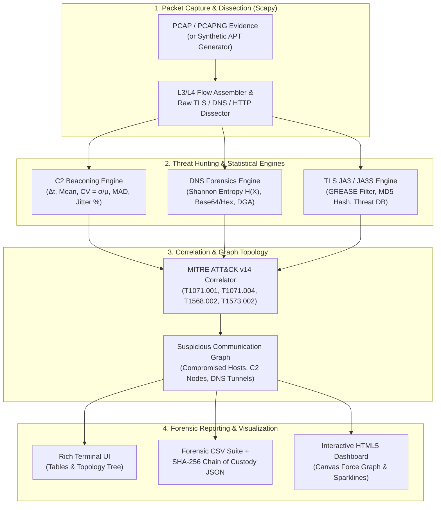

<div align="center">

# 📡 BeaconHunter — PCAP Network Threat & C2 Beaconing Detector

<p align="center">
  <b>Network forensics and threat hunting engine for detecting stealthy C2 beaconing, DNS tunneling/exfiltration, DGA bursts, and malicious TLS JA3/JA3S fingerprints.</b><br/>
  <i>Direct evolution of <a href="https://github.com/Neidielli/BasicTools">BasicTools</a> & <a href="https://github.com/Neidielli/ClientServer">ClientServer</a> — mapped to MITRE ATT&CK v14.</i>
</p>

[](https://www.python.org/)
[](https://github.com/Neidielli/BeaconHunter)
[](https://attack.mitre.org/)
[](LICENSE)

</div>

---

## 🧭 Overview

Modern Command and Control (C2) frameworks (**Cobalt Strike**, **Sliver**, **Mythic**, **Havoc**) evade traditional firewall and signature-based IDS rules by encrypting payloads over standard HTTPS/mTLS, introducing randomized sleep **jitter**, or tunneling exfiltrated data inside DNS queries.

**BeaconHunter** is a standalone network forensics and threat hunting engine powered by **Scapy** (zero external dependency on Wireshark/tshark binaries) that dissects `.pcap` / `.pcapng` packet captures to uncover covert adversary channels:

* 🎯 **Statistical C2 Beaconing Detection:** Analyzes inter-arrival times ($\Delta t$) across directional TCP/HTTP/TLS flows using Coefficient of Variation ($CV = \sigma/\mu$), Median Absolute Deviation ($MAD$), and jitter estimation to flag periodic heartbeats even under 10–30% randomized jitter.
* 🧬 **DNS Forensics (Tunneling, Exfiltration & DGA):**
  * Calculates **Shannon Entropy** $H(X)$ on subdomain labels and detects Base64, Base32, and Hexadecimal payload chunks (`T1071.004`, `T1048.003`).
  * Detects **Domain Generation Algorithm (DGA)** bursts and `NXDOMAIN` (`rcode=3`) spikes using consonant-to-vowel ratios, alphanumeric mixing, and bigram legibility heuristics (`T1568.002`).
* 🔐 **Raw TLS/SSL JA3 & JA3S Fingerprinting:** Byte-level RFC 5246/8446 TLS `ClientHello` and `ServerHello` parser that strips RFC 8701 GREASE values and computes canonical **Salesforce JA3 / JA3S** MD5 hashes (`T1573.002`).
* 🕸️ **Forensic Evidence Suite & Interactive Topology Graph:** Automatically generates 5 structured `.csv` reports, a Graphviz `.dot` topology file, a cryptographic SHA-256 Chain of Custody manifest (`evidence_manifest.json`), and a **100% offline HTML5 Interactive Dashboard** (`report.html`) with a draggable force-directed network graph.
* 🧪 **Built-In APT Traffic Simulator:** Includes a synthetic PCAP generator (`beaconhunter simulate`) that crafts multi-stage Cobalt Strike, Sliver mTLS, DNS Base64 Exfiltration, and DGA traffic for instant testing and portfolio demonstrations.

---

## 🏗️ Architecture



---

## 📐 Mathematical & Forensic Foundations

### 1. Statistical C2 Beaconing & Jitter Resilience
For each outbound flow $(IP_{src}, IP_{dst}, Port_{dst})$, sub-second handshake bursts are collapsed into logical heartbeat timestamps $t_1, t_2, \dots, t_n$, yielding inter-arrival intervals $\Delta t_i = t_i - t_{i-1}$. BeaconHunter computes:

$$\mu = \frac{1}{k}\sum_{i=1}^{k} \Delta t_i, \quad \sigma = \sqrt{\frac{1}{k-1}\sum_{i=1}^{k}(\Delta t_i - \mu)^2}, \quad CV = \frac{\sigma}{\mu}$$

$$\text{MAD} = \text{median}\left(|\Delta t_i - \text{median}(\Delta t)|\right), \quad \text{Jitter \%} = \frac{\text{mean}(|\Delta t_i - \text{median}(\Delta t)|)}{\text{median}(\Delta t)} \times 100$$

Combining $CV$ and outlier-resistant $\text{MAD}$ allows BeaconHunter to accurately detect Cobalt Strike and Sliver implants even when operators configure randomized sleep jitter up to $25\%$.

### 2. Shannon Entropy for DNS Tunneling & DGA
For every queried subdomain payload $S$ of length $N$, BeaconHunter calculates the **Shannon Entropy** in bits per character:

$$H(S) = -\sum_{c \in \Sigma} P(c) \log_2 P(c), \quad \text{where } P(c) = \frac{\text{count}(c)}{N}$$

- **Natural English domains:** $H(S) \approx 2.2 - 3.1$ bits/char.
- **Base64 / Hex Exfiltration & Encrypted DNS Tunnels:** $H(S) \ge 3.75 - 4.70$ bits/char with abnormal label lengths ($>24$ bytes) and elevated `TXT`/`NULL`/`CNAME` query ratios.

### 3. TLS JA3 & JA3S Fingerprinting (Salesforce Specification)
BeaconHunter parses raw TCP segments for TLS Handshake records (`0x16`), removes RFC 8701 GREASE values, and constructs deterministic MD5 fingerprints:
- **JA3 (ClientHello):** `MD5(SSLVersion,Ciphers,Extensions,EllipticCurves,EllipticCurvePointFormats)`
- **JA3S (ServerHello):** `MD5(SSLVersion,Cipher,Extensions)`

---

## ⚡ Quick Start

### 1. Installation

```bash
# Clone the repository
git clone https://github.com/Neidielli/BeaconHunter.git
cd BeaconHunter

# Install dependencies
pip install -r requirements.txt
```

### 2. Generate Synthetic APT PCAP & Run Full Threat Hunt

Don't have a malicious PCAP handy? Generate a realistic multi-stage intrusion capture (Cobalt Strike HTTPS beacon, Sliver mTLS beacon, DNS Base64 exfiltration, and DGA burst) and analyze it in one command:

```bash
python -m beaconhunter.cli simulate --pcap samples/c2_apt_intrusion.pcap --analyze --output output
```

### 3. Analyze Any Existing PCAP / PCAPNG File

```bash
python -m beaconhunter.cli scan --input samples/c2_apt_intrusion.pcap --output output
```

### 4. Inspect Built-In Malicious JA3 / JA3S Threat Database

```bash
python -m beaconhunter.cli ja3-db
```

---

## 📂 Exported Forensic Artifacts (`output/`)

Every scan automatically produces a complete forensic evidence package compliant with **ISO/IEC 27037:2012** and **RFC 3227**:

| File | Description |
| :--- | :--- |
| [`report.html`](output/report.html) | **Standalone Interactive HTML5 Dashboard** with draggable force-directed network topology graph, C2 interval sparklines, DNS entropy tables, and live MITRE ATT&CK filters. |
| [`threat_alerts.csv`](output/threat_alerts.csv) | Prioritized forensic alert timeline mapped to MITRE ATT&CK v14 Tactics & Techniques. |
| [`c2_beacons.csv`](output/c2_beacons.csv) | Statistical C2 beaconing metrics ($\mu$, median, $\sigma$, MAD, Jitter %, $CV$, Periodicity Score, correlated JA3). |
| [`dns_forensics.csv`](output/dns_forensics.csv) | DNS Tunneling / Exfiltration and DGA burst findings with Shannon entropy and estimated exfiltrated bytes. |
| [`tls_ja3_fingerprints.csv`](output/tls_ja3_fingerprints.csv) | Extracted TLS `ClientHello` (JA3) and `ServerHello` (JA3S) MD5 hashes, raw strings, SNI, and threat matches. |
| [`network_graph_edges.csv`](output/network_graph_edges.csv) | Directed communication edges between internal hosts, C2 servers, and suspicious domains. |
| [`network_topology.dot`](output/network_topology.dot) | Graphviz DOT specification of the suspicious communication topology. |
| [`evidence_manifest.json`](output/evidence_manifest.json) | Cryptographic **Chain of Custody** manifest containing SHA-256 hashes of the source PCAP and all exported artifacts. |

---

## 🧪 Running Automated Tests

```bash
python run_tests.py
```

---

## 📄 License

Distributed under the [MIT](LICENSE) License. See `LICENSE` for more information.

<div align="center">
  <sub>Developed by <a href="https://github.com/Neidielli">Neidielli Rosado</a> • Cybersecurity & Software Engineering</sub>
</div>
